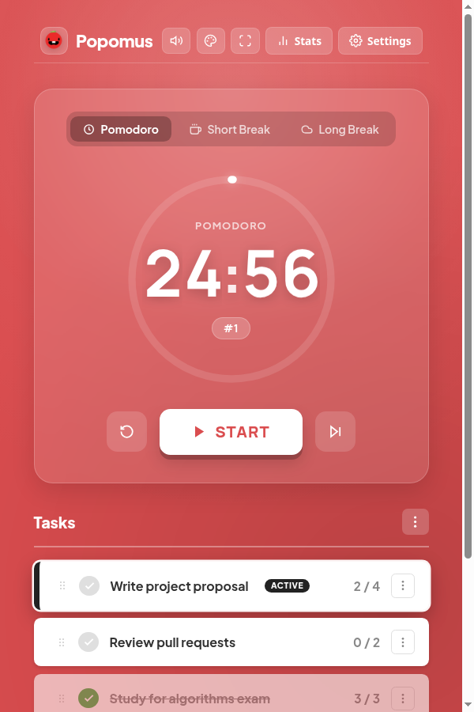
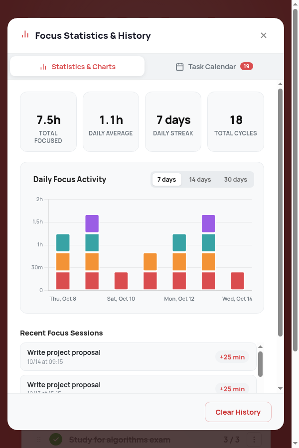
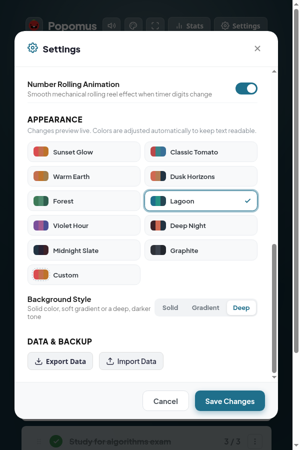

# 🍅 Popomus
A customizable Pomodoro timer with task management, focus analytics and native Linux desktop integration. It runs as a GTK/WebKit desktop app or in any modern browser, fully offline.

<p align="center">
  
  
  
</p>

## Features

- **Timer & cycles**: configurable focus, short and long breaks, auto-start options, and a countdown that stays accurate across sleep and suspend.
- **Tasks**: estimates, per-task timers, drag-and-drop (or keyboard) reordering, and the time spent on each task.
- **Analytics**: daily focus chart per task, streaks, session log and an all-time calendar of completed tasks.
- **Themes**: 10 presets plus custom colors, solid, gradient or deep backgrounds, and live preview. Colors are adjusted automatically to keep text readable.
- **Sound**: four alarm chimes, an optional ticking sound and volume control (played through PipeWire/PulseAudio on the desktop).
- **Desktop integration**: native window, system tray, desktop notifications and single-instance focus.
- **Your data stays local**: stored on disk under `~/.local/share/pomus/`, with JSON export and import.

## Quick start

### Desktop (Linux)

```bash
./pomus            # or: python3 app.py
```

| Flag | Effect |
| --- | --- |
| `--minimized` | Start hidden in the system tray |
| `--browser` | Serve the app and open it in your default browser |
| `--no-tray` | Run without the tray icon |
| `--port N` | Use a different local port (default `58241`) |

### Browser only

Open `index.html` in any modern browser. Disk sync and native notifications need the local server (`app.py`); everything else works standalone.

## Installation

Add Popomus to your application menu (user-local, no `sudo`):

```bash
./install.sh      # remove with ./uninstall.sh
```

### Requirements (desktop mode)

- Python 3.8+
- PyGObject and WebKit2GTK
- Optional: `libnotify` (notifications) and `libayatana-appindicator` (tray icon)

**Arch Linux**

```bash
sudo pacman -S python-gobject webkit2gtk libnotify libayatana-appindicator
```

**Debian / Ubuntu**

```bash
sudo apt install python3-gi gir1.2-webkit2-4.1 libnotify-bin gir1.2-ayatanaappindicator3-0.1
```

## Keyboard shortcuts

| Key | Action |
| --- | --- |
| `Space` | Start / pause the timer |
| `Alt+R` / `Alt+S` | Reset / skip the current session |
| `F11` | Fullscreen |
| `Enter` on a task | Make it the active task |
| `Alt+↑` / `Alt+↓` on a task | Move it up / down |
| `F5`, `Ctrl+R` | Reload (desktop app) |

## Development

No build step or dependencies: the frontend is plain HTML, CSS and JavaScript, and the backend uses only the Python standard library (plus PyGObject for the desktop window).

```bash
npm test          # JavaScript (node:test) + Python (unittest) suites
npm run check     # syntax check for every script
```

The tests need Node.js 22+ and Python 3.8+. CI runs them on every push and pull request.

### Project structure

```text
├── app.py              # Local HTTP server + GTK3/WebKit2 desktop wrapper
├── index.html          # Web app entry point
├── css/styles.css      # Interface styles
├── js/
│   ├── app.js          # UI orchestration: timer, tasks, dialogs, shortcuts
│   ├── timer.js        # Pomodoro timer engine (wall-clock based)
│   ├── tracking.js     # Credits focus time exactly once across pauses
│   ├── storage.js      # Persistence (localStorage + disk sync), export/import
│   ├── themes.js       # Color presets, background styles, contrast math
│   ├── ui.js           # Custom select menus, confirm dialog, toasts
│   ├── chart.js        # Focus statistics chart
│   ├── calendar.js     # All-time completed tasks calendar
│   ├── audio.js        # Alarm/tick sounds (native bridge, Web Audio, HTML5)
│   └── roller.js       # Rolling-digit animation
├── assets/
│   ├── fonts/          # Self-hosted variable fonts (OFL)
│   ├── sounds/         # Alarm and UI sounds (.wav)
│   ├── icon.png, icon.svg
│   └── chart.umd.min.js  # Chart.js 4.4.1
├── tests/              # js/ (node:test) and python/ (unittest)
├── docs/screenshots/
├── install.sh, uninstall.sh, pomus, pomus.desktop
└── package.json        # Test scripts only, no dependencies
```
